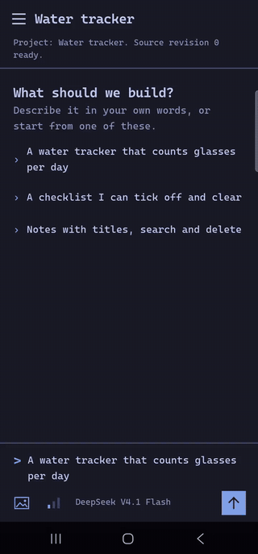
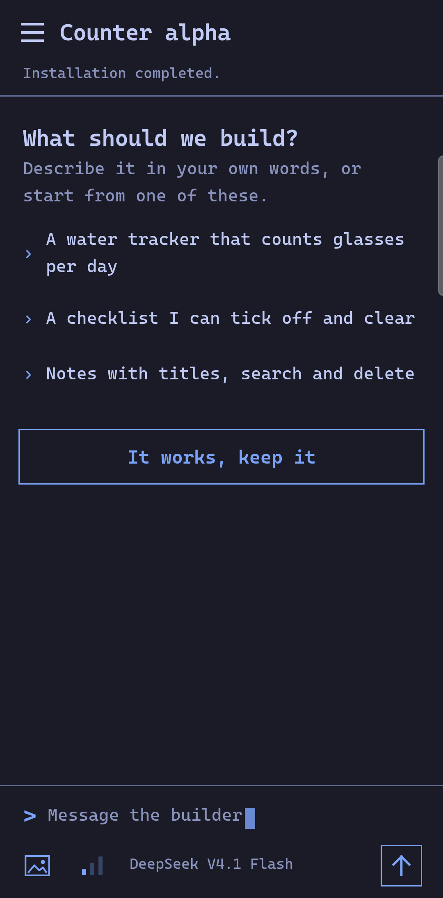
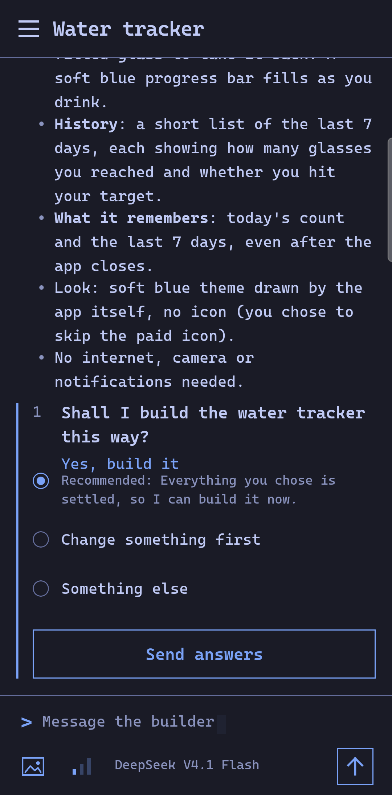
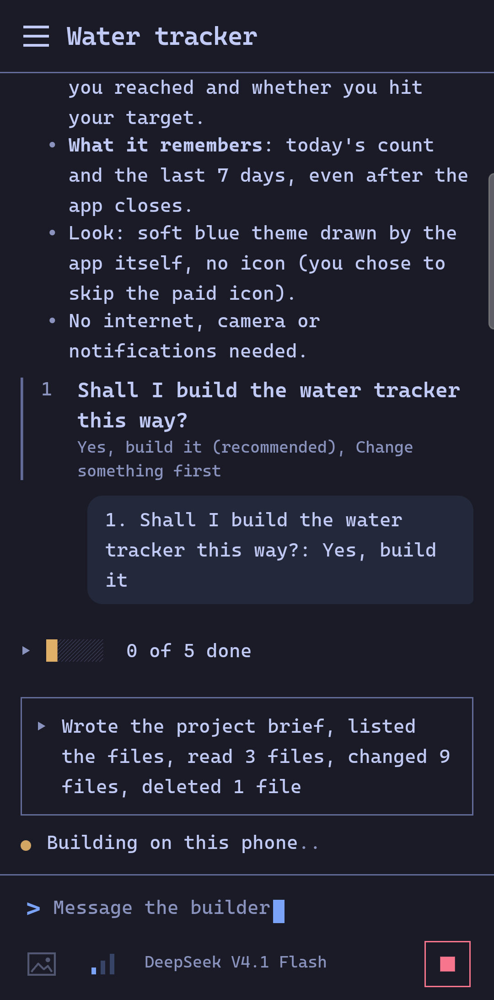
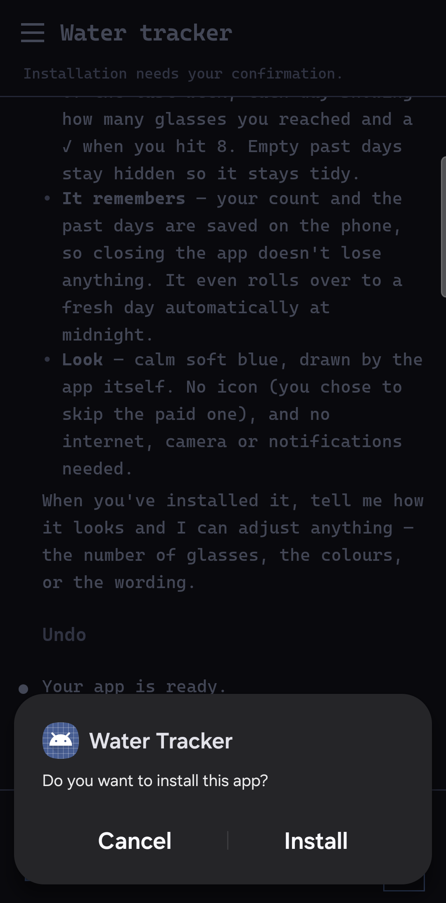
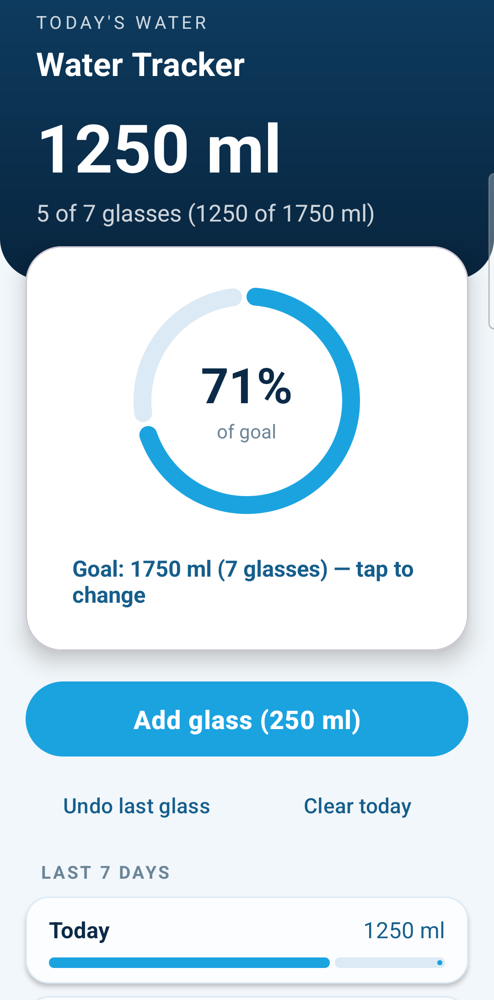
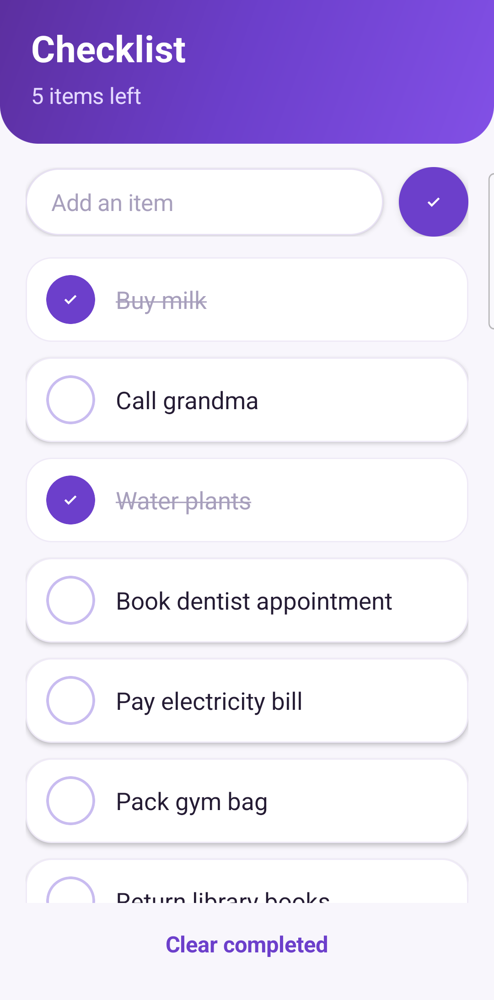
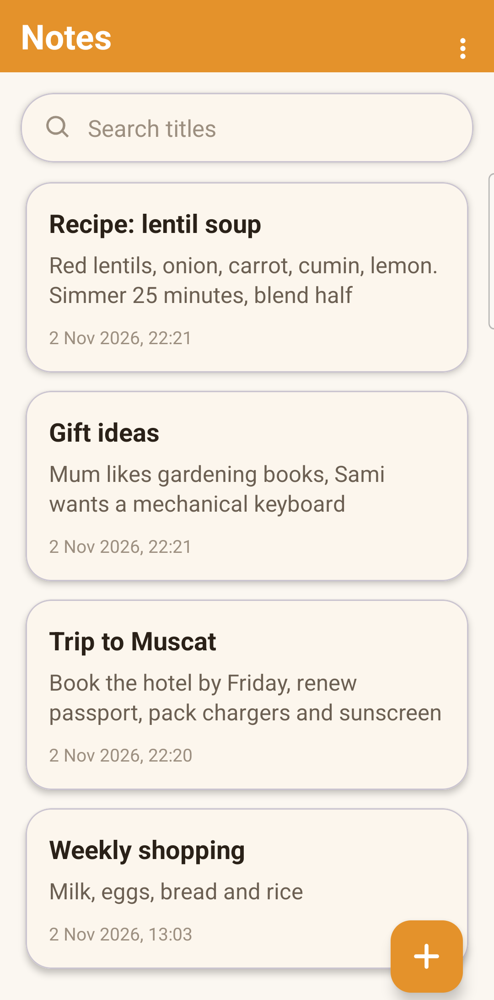
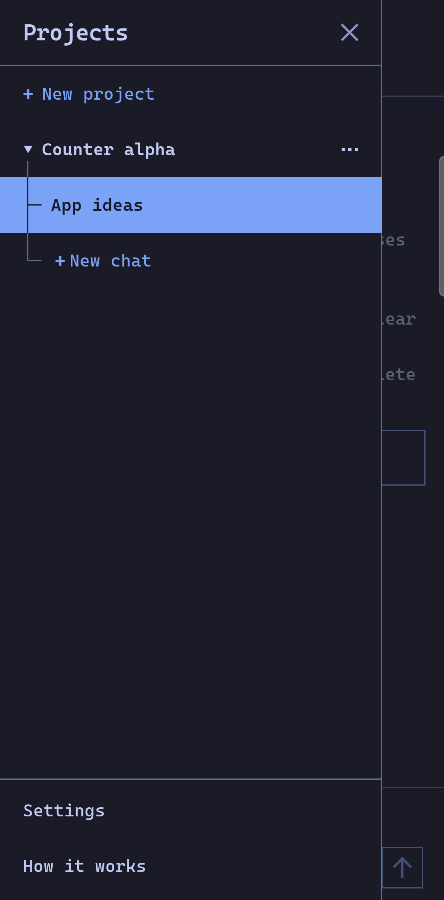

# Smallwright

An Android app that builds Android apps on the phone. You describe an app in a
chat; a cloud model writes plain Java and XML; the phone compiles, signs and
installs it. Only the model runs in the cloud. Source files, the compiler,
builds and the finished apps stay on the phone.

Alpha, tested on real phones.

<p align="center">
  
</p>

## Screens

<p>
  
  
  
  
</p>

<p>
  
  
  
  
</p>

## Requirements

- Android 12 or newer on a 64-bit ARM phone.
- An [OpenRouter](https://openrouter.ai) account (sign in from the app, or
  paste a key), or an API key for any OpenAI-compatible service. Requests are paid by you, per request, with no
  spending limit set by the app. Your messages, the project's source files and
  any pictures you attach are sent to that service and the model you pick.
  Requests to OpenRouter name Smallwright as the app, so its use shows in
  OpenRouter's public app rankings; nothing about you is added. Web search, app icons and pictures, attached pictures, cost totals and the
  spending limit need OpenRouter.

## Install

Download the builder APK from the
[latest release](https://github.com/Mouhand-Kaddo/smallwright/releases/latest)
and install it. The builder
carries the worker: tap **Install the build worker** on its main screen and
confirm Android's prompt. After a builder update, tap **Update the build
worker** the same way.

To get updates, add `https://github.com/Mouhand-Kaddo/smallwright` in
[Obtainium](https://github.com/ImranR98/Obtainium).

## How it works

- **Builder** (`dev.smallwright.controller`) holds your projects, your model key
  and the chat. It asks before new apps, plans, edits in steps until the model
  is done, and can run in the background.
- **Worker** (`dev.smallwright.worker`) compiles each project with ECJ, D8 and
  AAPT2. It is a separate app with its own Android user and no Internet
  permission, and it accepts only the builder signed with the same key.
- Each project gets its own signing key. Installing an app goes through
  Android's own confirmation screen. Generated code never runs inside the
  builder.
- On first start the builder shows Google's Android SDK terms and, once you
  accept them, downloads Google's Android platform files to the phone.

## Build from source

On Linux x86_64 with `curl`, `unzip` and `python3`:

```bash
scripts/bootstrap.sh
source scripts/env.sh
./gradlew assembleDebug
```

`bootstrap.sh` downloads a JDK, the Android SDK packages (you accept Google's
licenses), and the pinned ECJ, R8 and AAPT2 into ignored folders, checking each
file's SHA-256. AAPT2 is built from AOSP source by
`scripts/build_aapt2_source_candidate.sh`; see
[the build record](docs/validation/aapt2-source-build.md).

Debug builds are signed with your machine's Android debug key. For signed
release builds, create a key once and keep a backup of `signing/`; without it
installed apps cannot be updated:

```bash
scripts/create-signing.sh release
./gradlew assembleRelease
```

Each builder APK carries the worker of the same build type, signed with the
same key.

## Docs

- [Status](docs/STATUS.md) and [testing](docs/TESTING.md)
- [Decisions](docs/adr/)
- [Third-party licenses](toolchain/licenses/INDEX.md)

## License

Apache-2.0, see [LICENSE](LICENSE). Third-party files keep their own licenses;
see [NOTICE](NOTICE).
